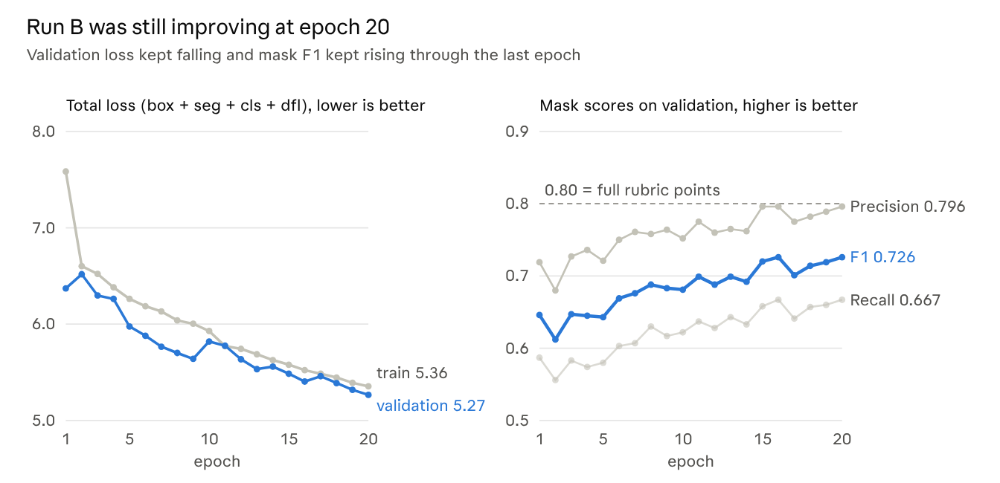

# Run B analysis: no preprocessing, YOLO11n-seg, 20 epochs

Nov 15, 2026

On the 777-image test set Run B scores mask precision 0.789, recall 0.746 and F1 0.767. At confidence 0.30 instead of 0.25 that becomes about 26 of 30 rubric points. It was still improving at epoch 20, so a longer run should score higher.

## Setup

Run B is thejan's "Apple leaf disease seg - B (no preproc)" v3: the doc 3 workflow with the Image preprocessing studio removed, so the model trains on the original photos. Training was run #31 (yrawale, A0002). Inference was re-run as #35 after a path fix (see Bugs).

| Setting | Value |
| --- | --- |
| Model | yolo11n-seg.pt (nano, 2.85M parameters, 9.7 GFLOPs) |
| Task | Instance segmentation, 3 classes: apple_scab, black_rot, spot (cedar apple rust) |
| Data | /fs/ess/A0002/hackathon/apple_leaves/dataset (data.yaml) |
| Validation set | 2,331 images, 38,270 labelled spots |
| Test set | 777 images in dataset/test/images, 12,263 labelled spots |
| Epochs / patience | 20 / 10 |
| Batch / image size | 16 / 640 px |
| lr0 / lrf / optimizer | 0.01 / 0.01 / auto |
| Seed | 42 (repeatable) |
| Hardware | 1x NVIDIA A10G (aws-tapis, a10g-partition), 4.1 GB GPU memory used |
| Training time | 18.5 min (0.308 h): about 61 s per epoch for epochs 1-10, 47 s for 11-20 |
| Output | best.pt and last.pt, 6.0 MB each; best.pt = epoch 20 |

Epochs got faster at epoch 11 because YOLO switches off mosaic augmentation for the last 10 epochs (close_mosaic = 10).

## Final scores (validation)

On the validation set best.pt scores mask precision 0.796, recall 0.668 and F1 0.727: 8 + 8 + 8 = 24 of the rubric's 30 Model Performance points. Precision is 0.004 short of the 0.80 band that pays 10.

| Class | Val images | Labelled spots | Mask P | Mask R | Mask F1 | Mask mAP50 | Mask mAP50-95 |
| --- | --- | --- | --- | --- | --- | --- | --- |
| All | 2,331 | 38,270 | 0.796 | 0.668 | 0.727 | 0.744 | 0.342 |
| spot (cedar apple rust) | 522 | 15,776 | 0.833 | 0.705 | 0.764 | 0.793 | 0.355 |
| black_rot | 569 | 8,103 | 0.807 | 0.667 | 0.730 | 0.754 | 0.352 |
| apple_scab | 611 | 14,391 | 0.746 | 0.631 | 0.684 | 0.685 | 0.319 |

Box scores are higher than mask scores (box P 0.850, R 0.739, F1 0.791, mAP50 0.845, mAP50-95 0.482). The model finds and names the spots better than it traces their exact outline. If the judges score boxes, the same model earns 10 + 8 + 8 = 26 points.

Recall is the weak side: about one labelled spot in three is missed. Apple scab is the hardest class on every measure; its lesions are small, diffuse and olive-brown against a green leaf. Validation numbers are not the test-set numbers the rubric grades; those are in Test-set results below.

## Training curves

Both lines in the left panel fall together, which is real learning rather than memorising. On the right, F1 climbs from 0.646 to 0.726 with no plateau yet, and precision touches the 0.80 line without crossing it. The same curves, plus box metrics and learning rate, are in run #35's Visualization block in the Workflow Studio.

Source: run #31 results.csv (Ultralytics), validation set. Total loss = box + seg + cls + dfl.

| Epoch | Train loss | Val loss | Mask P | Mask R | Mask F1 | Mask mAP50 | Mask mAP50-95 |
| --- | --- | --- | --- | --- | --- | --- | --- |
| 1 | 7.58 | 6.37 | 0.719 | 0.587 | 0.646 | 0.648 | 0.296 |
| 2 | 6.60 | 6.52 | 0.680 | 0.556 | 0.612 | 0.606 | 0.240 |
| 3 | 6.52 | 6.30 | 0.727 | 0.583 | 0.647 | 0.664 | 0.272 |
| 4 | 6.38 | 6.26 | 0.736 | 0.574 | 0.645 | 0.651 | 0.261 |
| 5 | 6.26 | 5.98 | 0.721 | 0.580 | 0.643 | 0.653 | 0.264 |
| 6 | 6.19 | 5.88 | 0.750 | 0.603 | 0.669 | 0.683 | 0.297 |
| 7 | 6.13 | 5.77 | 0.761 | 0.607 | 0.676 | 0.698 | 0.317 |
| 8 | 6.04 | 5.70 | 0.758 | 0.630 | 0.688 | 0.706 | 0.322 |
| 9 | 6.00 | 5.64 | 0.764 | 0.617 | 0.683 | 0.701 | 0.320 |
| 10 | 5.93 | 5.82 | 0.752 | 0.622 | 0.681 | 0.702 | 0.291 |
| 11 | 5.77 | 5.78 | 0.775 | 0.637 | 0.699 | 0.714 | 0.303 |
| 12 | 5.74 | 5.64 | 0.760 | 0.628 | 0.688 | 0.712 | 0.317 |
| 13 | 5.69 | 5.53 | 0.765 | 0.643 | 0.699 | 0.716 | 0.310 |
| 14 | 5.63 | 5.56 | 0.762 | 0.633 | 0.692 | 0.708 | 0.301 |
| 15 | 5.58 | 5.49 | 0.796 | 0.658 | 0.720 | 0.744 | 0.326 |
| 16 | 5.52 | 5.40 | 0.796 | 0.667 | 0.726 | 0.741 | 0.341 |
| 17 | 5.49 | 5.46 | 0.775 | 0.641 | 0.701 | 0.725 | 0.313 |
| 18 | 5.45 | 5.39 | 0.782 | 0.657 | 0.714 | 0.731 | 0.326 |
| 19 | 5.39 | 5.32 | 0.789 | 0.660 | 0.719 | 0.738 | 0.338 |
| 20 | 5.36 | 5.27 | 0.796 | 0.667 | 0.726 | 0.744 | 0.342 |

## Did it converge?

No, not fully: Run B was still learning at epoch 20, with gains slowing but not stopped. It did not get stuck and did not overfit.

- **Real learning, no overfitting.** Total training loss fell 29%, from 7.58 to 5.36. Total validation loss fell 17%, from 6.37 to 5.27, and its lowest point is the last epoch. Validation loss rising while training loss falls would mean memorising; that never happened.
- **Still improving at the end.** Mask mAP50-95 rose from 0.296 (epoch 1) to 0.342 (epoch 20), +0.016 over the last 5 epochs. Mask F1 rose from 0.646 to 0.726. Both peaked on the final epoch, so best.pt = last.pt.
- **Early stopping never fired.** Patience was 10 epochs; the model kept setting new bests, so all 20 epochs ran.
- **Noisy from epoch to epoch.** Mask mAP50-95 dipped at epochs 2, 10, 14 and 17 (0.240 at epoch 2, during the 3-epoch learning-rate warm-up). Compare runs on their final or best value, not on one middle epoch.
- **A step at epoch 11.** Training loss dropped faster there (seg 2.35 to 2.24) because mosaic augmentation switches off for the last 10 epochs, so training images look like the real ones.
- **Strong start.** Epoch 1 already had mask F1 0.646 because the model starts from weights pre-trained on COCO; the 20 epochs added +0.08 F1.

## Test-set results

On the 777 unseen test images Run B scores mask precision 0.789, recall 0.746 and F1 0.767 at the default confidence 0.25. Raising the threshold to 0.30 lifts precision to 0.830 and is worth about 26 rubric points instead of 24, with no retraining.

Inference (run #35) predicted 11,594 spots on 777 images, 14.9 per image, in 11.3 ms per image on the A10G. The Workflow Studio does not score the test set, so we wrote `eval_test.py`: a predicted mask counts as correct when it overlaps an unmatched true mask of the same disease by IoU 0.5 or more (the standard rule).

| Confidence threshold | Precision | Recall | F1 | Rubric points (P + R + F1) |
| --- | --- | --- | --- | --- |
| 0.25 (default) | 0.789 | 0.746 | 0.767 | 8 + 8 + 8 = 24 |
| **0.30** | **0.830** | **0.714** | **0.768** | **10 + 8 + 8 = 26** |
| 0.35 | 0.868 | 0.683 | 0.765 | 10 + 8 + 8 = 26 |
| 0.40 | 0.895 | 0.646 | 0.751 | 10 + 8 + 8 = 26 |
| 0.50 | 0.936 | 0.563 | 0.703 | 10 + 5 + 8 = 23 |

Per disease at 0.25:

| Class | True spots | Predicted | Precision | Recall | F1 |
| --- | --- | --- | --- | --- | --- |
| spot (cedar apple rust) | 5,039 | 4,715 | 0.822 | 0.769 | 0.795 |
| black_rot | 2,577 | 2,326 | 0.820 | 0.740 | 0.778 |
| apple_scab | 4,647 | 4,553 | 0.739 | 0.724 | 0.731 |

- **It never mixes up the diseases.** Of the predictions that land on a true spot, 0 carry the wrong disease name. The errors are all about finding spots (missed or extra), not naming them.
- **Healthy leaves stay almost clean.** The 209 healthy test images got 23 predicted spots in total, about 1 in 9 images.
- **Test beats validation.** Recall is 0.746 on test against 0.668 on validation; the two sets differ, so quote test numbers for grading and validation numbers for comparing runs.

The rubric's exact scoring method is not published, so these points are our estimate using the same 0.80 / 0.60 bands.

## Bugs found and fixed

Both bugs come from following doc 3 as written, so other teams will likely hit them too. They are good material for the video's Challenges section.

1. **Inference crashed: wrong test folder.** Run #31's Model Inference failed with `FileNotFoundError: No images or videos found in /job/images`. The guide points Image Directory #2 at `dataset/test`, but that folder holds only two subfolders (`images/` with 777 photos, `labels/`), and the inference script does not look inside subfolders.
   - Fix: point Image Directory #2 at `.../dataset/test/images`.
   - We did not retrain. Template "Run B - inference only (fixed test/images path)" v2 feeds Run B's best.pt through a Pretrained Model block into Model Inference, then Smart Labeler. Run #35 completed in about 4 minutes.
   - **thejan: your run uses the same path and will fail the same way.** Change it, or reuse your best.pt the same way.
2. **Hue shift only on training images.** thejan's first template turns on the preprocessing studio's HSV adjust with the guide's example hue shift of -33 degrees. It recolours only the training images; the test images go to inference untouched, so the model learns brown leaves and purple spots, then is tested on green leaves. It also scrambles the colours that tell the diseases apart. Run B (no preprocessing) avoids this; the run with the shift (Run A) becomes the comparison that shows its effect.

## What to change next

Run B is the baseline every other run is compared against. Each run below changes one thing, so any difference can be traced to it.

| Run | Change from Run B | What Run B shows | Expected cost |
| --- | --- | --- | --- |
| C | 60 epochs, patience 15, max runtime 120 min | Still improving at epoch 20; the undergrad winners' best run was also their longest | about 50 min GPU |
| D | CLAHE + sharpen preprocessing on training AND test images | Recall is low and apple scab lesions are faint; contrast may help (the winners' idea, applied to both sides) | about 20 min |
| A (thejan) | Hue shift on (doc 3 as written) | Measures what the mismatched preprocessing costs | running |
| Confidence threshold | Set inference confidence to 0.30 | Done from Run B's test predictions: 0.30 gives precision 0.830 and the best F1. Re-check on the final model | none, scored locally |

Keep the nano model. Frutiger, a placing undergrad team, went from YOLO nano to large for +0.55 points of precision; the rubric also gives 5 points for an edge-ready model, and ours is 6 MB with 11 ms per image.
